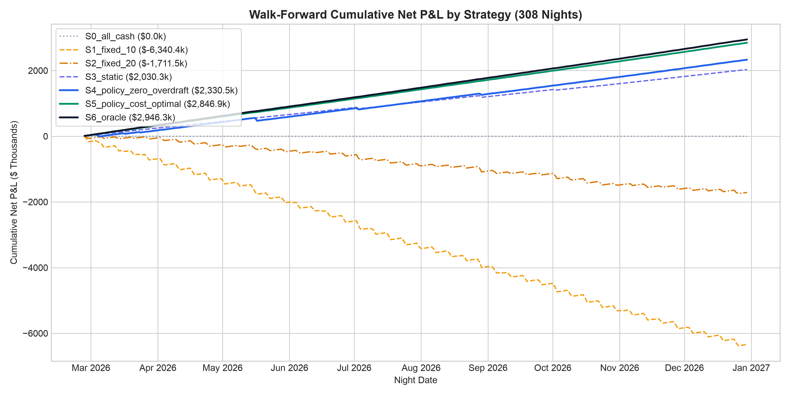
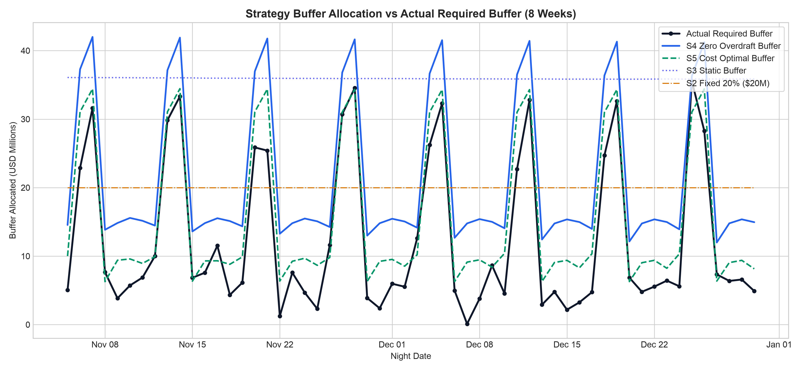

# Strategy Backtest and Policy Engine Results

Evaluation framework: 308 out-of-sample nights (indices 56 to 363). Each night starts with a replenished pool of $100,000,000. All decisions are executed at 17:00 and simulated over the 15-hour overnight window through 08:00 maturity.

> **Selection Bias Note**: The default model used for S4 and S5 (`MODEL_FOR_POLICY = 'B1'`) was selected based on achieving the lowest total cost in the Step 3 evaluation over the same out-of-sample nights. This diagnostic selection is subject to in-sample model selection bias.

---

## 1. Visualizations

---

## 2. Strategy Performance Comparison

### Table 1: All Evaluation Nights (308 Nights)

| Strategy | Total Interest ($) | Break Fees ($) | Overdraft Cost ($) | Net P&L ($) | Net Yield (bps) | Mean Buffer ($) | Break Nights | Overdraft Nights | Worst Shortfall ($) | Payout Success | Capture Ratio |
|:---|---:|---:|---:|---:|---:|---:|---:|---:|---:|---:|---:|
| `S0_all_cash` | 0.00 | 0.00 | 0.00 | 0.00 | 0.00 | 100,000,000.00 | 0 | 0 | 0.00 | 100.0% | 0.0000 |
| `S1_fixed_10` | 2,849,267.82 | 9,189,711.28 | 0.00 | -6,340,443.46 | -751.38 | 10,000,000.00 | 122 | 0 | 36,660,691.28 | 100.0% | -2.1520 |
| `S2_fixed_20` | 2,617,273.10 | 4,328,779.12 | 0.00 | -1,711,506.01 | -202.82 | 20,000,000.00 | 85 | 0 | 26,660,691.28 | 100.0% | -0.5809 |
| `S3_static` | 2,168,742.21 | 138,479.82 | 0.00 | 2,030,262.39 | 240.60 | 35,945,807.02 | 4 | 0 | 10,869,569.69 | 100.0% | 0.6891 |
| `S4_policy_zero_overdraft` | 2,653,808.27 | 323,269.29 | 0.00 | 2,330,538.98 | 276.18 | 21,522,953.54 | 10 | 0 | 18,941,086.62 | 100.0% | 0.7910 |
| `S5_policy_cost_optimal` | 2,866,323.24 | 0.00 | 19,471.63 | 2,846,851.61 | 337.37 | 15,460,999.97 | 0 | 70 | 21,153,755.59 | 100.0% | 0.9662 |
| `S6_oracle` | 2,946,341.25 | 0.00 | 0.00 | 2,946,341.25 | 349.16 | 13,103,605.46 | 0 | 0 | 0.00 | 100.0% | 1.0000 |

### Table 2: Friday & Saturday Nights Only (88 Nights)

| Strategy | Total Interest ($) | Break Fees ($) | Overdraft Cost ($) | Net P&L ($) | Net Yield (bps) | Mean Buffer ($) | Break Nights | Overdraft Nights | Worst Shortfall ($) | Payout Success | Capture Ratio |
|:---|---:|---:|---:|---:|---:|---:|---:|---:|---:|---:|---:|
| `S0_all_cash` | 0.00 | 0.00 | 0.00 | 0.00 | 0.00 | 100,000,000.00 | 0 | 0 | 0.00 | 100.0% | 0.0000 |
| `S1_fixed_10` | 681,130.89 | 8,672,465.89 | 0.00 | -7,991,335.00 | -3314.59 | 10,000,000.00 | 88 | 0 | 36,660,691.28 | 100.0% | -11.7325 |
| `S2_fixed_20` | 680,644.77 | 4,294,684.50 | 0.00 | -3,614,039.72 | -1499.01 | 20,000,000.00 | 84 | 0 | 26,660,691.28 | 100.0% | -5.3059 |
| `S3_static` | 617,582.21 | 138,479.82 | 0.00 | 479,102.39 | 198.72 | 35,943,850.33 | 4 | 0 | 10,869,569.69 | 100.0% | 0.7034 |
| `S4_policy_zero_overdraft` | 593,560.99 | 91,295.47 | 0.00 | 502,265.51 | 208.33 | 38,515,092.92 | 2 | 0 | 9,530,092.24 | 100.0% | 0.7374 |
| `S5_policy_cost_optimal` | 655,052.18 | 0.00 | 4,150.96 | 650,901.22 | 269.98 | 32,389,201.96 | 0 | 23 | 13,744,937.59 | 100.0% | 0.9556 |
| `S6_oracle` | 681,130.89 | 0.00 | 0.00 | 681,130.89 | 282.51 | 29,710,149.75 | 0 | 0 | 0.00 | 100.0% | 1.0000 |

### Table 3: Nights Containing a >4-Sigma Outlier Hour (24 Nights)

| Strategy | Total Interest ($) | Break Fees ($) | Overdraft Cost ($) | Net P&L ($) | Net Yield (bps) | Mean Buffer ($) | Break Nights | Overdraft Nights | Worst Shortfall ($) | Payout Success | Capture Ratio |
|:---|---:|---:|---:|---:|---:|---:|---:|---:|---:|---:|---:|
| `S0_all_cash` | 0.00 | 0.00 | 0.00 | 0.00 | 0.00 | 100,000,000.00 | 0 | 0 | 0.00 | 100.0% | 0.0000 |
| `S1_fixed_10` | 238,696.09 | 779,954.05 | 0.00 | -541,257.96 | -759.84 | 10,000,000.00 | 11 | 0 | 36,660,691.28 | 100.0% | -2.1881 |
| `S2_fixed_20` | 218,788.18 | 393,943.68 | 0.00 | -175,155.50 | -245.89 | 20,000,000.00 | 5 | 0 | 26,660,691.28 | 100.0% | -0.7081 |
| `S3_static` | 180,074.63 | 101,831.42 | 0.00 | 78,243.22 | 109.84 | 35,876,975.91 | 2 | 0 | 10,869,569.69 | 100.0% | 0.3163 |
| `S4_policy_zero_overdraft` | 226,709.88 | 270,049.56 | 0.00 | -43,339.69 | -60.84 | 18,164,178.24 | 6 | 0 | 18,941,086.62 | 100.0% | -0.1752 |
| `S5_policy_cost_optimal` | 249,345.73 | 0.00 | 9,841.15 | 239,504.58 | 336.23 | 12,269,079.45 | 0 | 11 | 21,153,755.59 | 100.0% | 0.9682 |
| `S6_oracle` | 247,360.64 | 0.00 | 0.00 | 247,360.64 | 347.26 | 12,940,570.76 | 0 | 0 | 0.00 | 100.0% | 1.0000 |

### Table 4: Diagnostic Sensitivity for S4 Across Quantiles (Evaluated on Same Nights, Not Tuned)

| Quantile $q$ | Mean Buffer ($) | Total Interest ($) | Break Fees ($) | Overdraft Cost ($) | Net P&L ($) | Net Yield (bps) | Break Nights | Overdraft Nights | Capture Ratio |
|---:|---:|---:|---:|---:|---:|---:|---:|---:|---:|
| 0.900 | 17,247,223.36 | 2,790,247.39 | 704,509.64 | 0.00 | 2,085,737.75 | 247.17 | 40 | 0 | 0.7079 |
| 0.950 | 19,037,964.22 | 2,734,570.99 | 475,306.28 | 0.00 | 2,259,264.70 | 267.74 | 21 | 0 | 0.7668 |
| 0.980 | 21,655,116.39 | 2,649,369.94 | 319,833.75 | 0.00 | 2,329,536.19 | 276.07 | 10 | 0 | 0.7907 |
| 0.990 | 23,159,633.12 | 2,598,568.58 | 296,064.78 | 0.00 | 2,302,503.80 | 272.86 | 9 | 0 | 0.7815 |
| 0.995 | 23,159,633.12 | 2,598,568.58 | 296,064.78 | 0.00 | 2,302,503.80 | 272.86 | 9 | 0 | 0.7815 |

