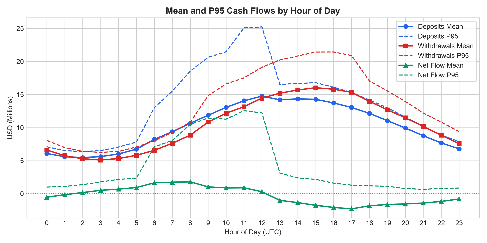
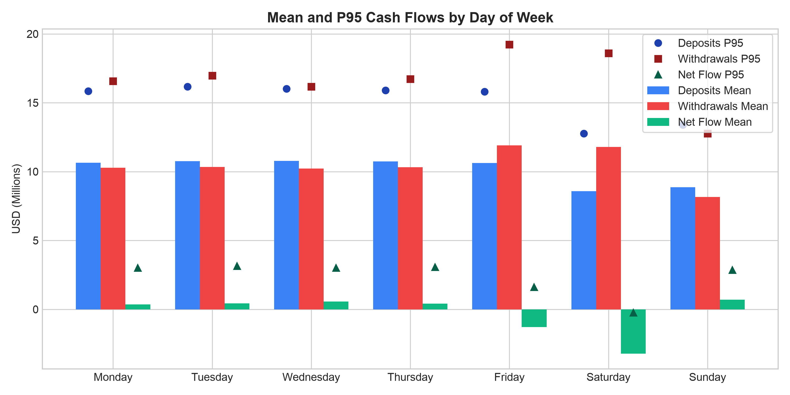
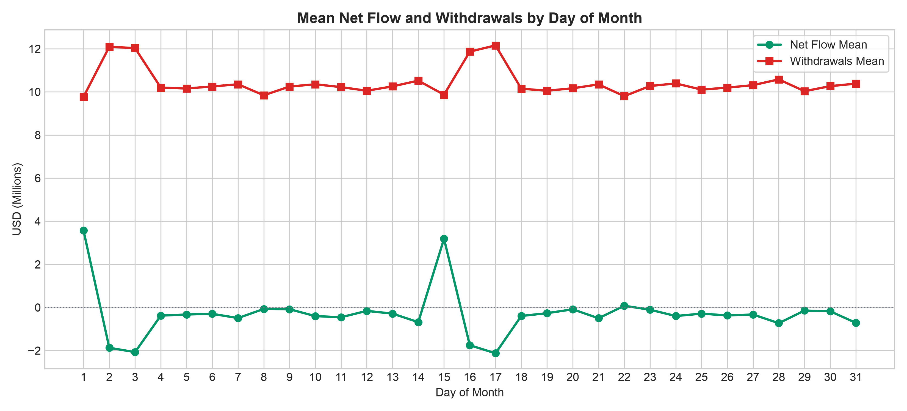
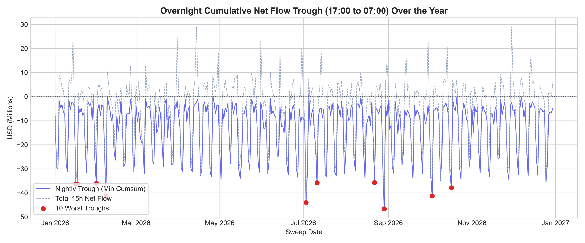
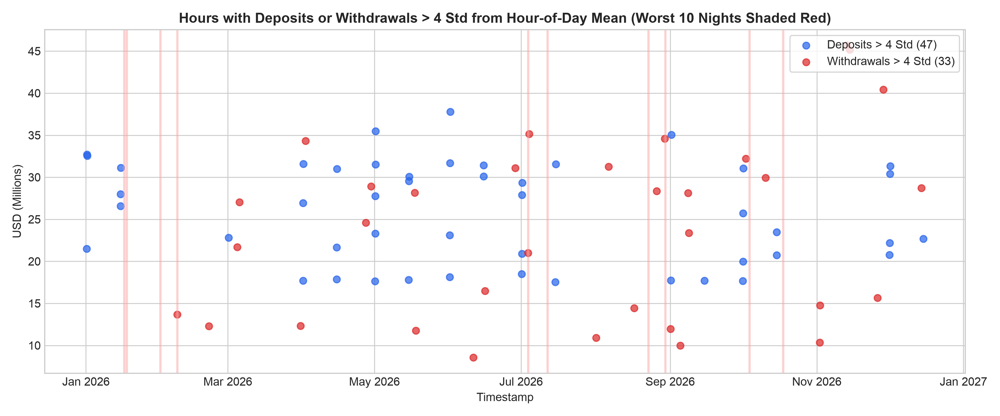
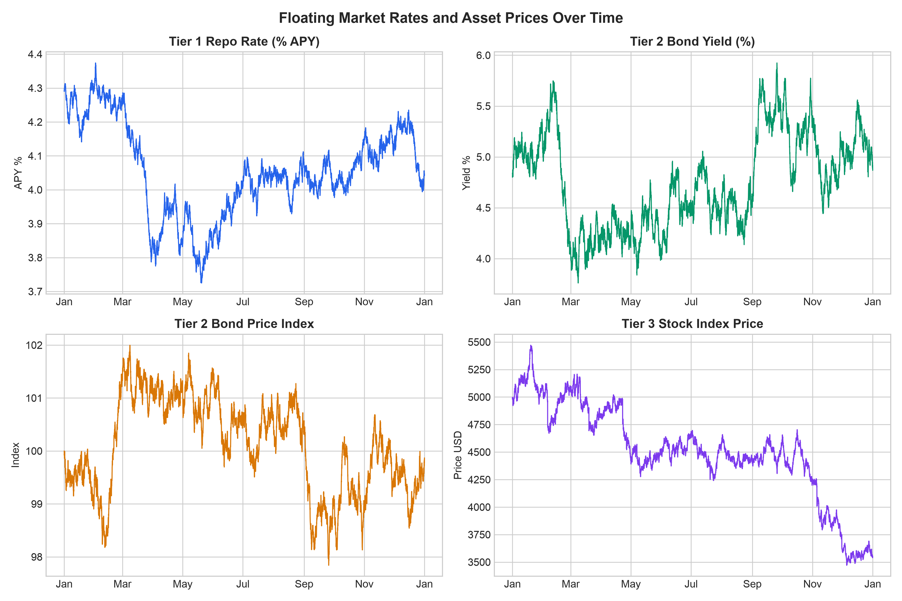
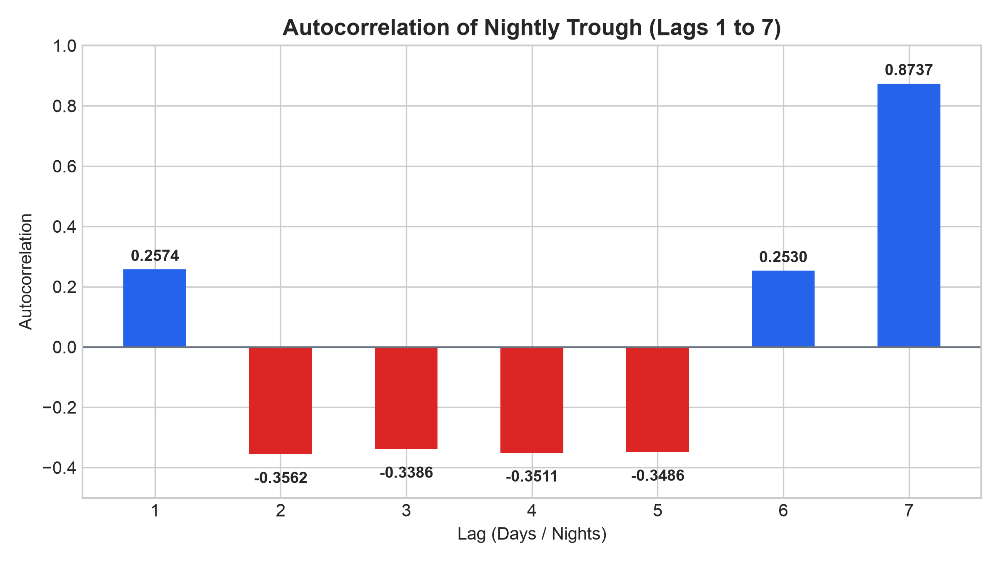

# Exploratory Data Analysis (EDA) Findings

All figures and tables in this document were computed directly from `market_data` in PostgreSQL (8,760 hourly rows from 2026-01-01 00:00:00 to 2026-12-31 23:00:00).

> **Assumption**: Cash flows in the 17:00 row occur *after* the overnight sweep decision is executed at 17:00.

---

## 1. Cash Flows by Hour of Day (0-23)

| Hour | Deposits Mean ($) | Deposits P95 ($) | Withdrawals Mean ($) | Withdrawals P95 ($) | Net Flow Mean ($) | Net Flow P95 ($) |
|---|---:|---:|---:|---:|---:|---:|
| 00 | 6,078,882.44 | 7,097,751.05 | 6,608,273.63 | 8,064,067.84 | -529,391.19 | 1,003,469.13 |
| 01 | 5,593,579.78 | 6,514,187.26 | 5,740,522.72 | 6,979,049.77 | -146,942.93 | 1,098,854.62 |
| 02 | 5,461,089.10 | 6,377,470.33 | 5,288,184.32 | 6,396,008.93 | 172,904.78 | 1,369,116.07 |
| 03 | 5,609,556.50 | 6,518,463.59 | 5,096,525.54 | 6,256,317.80 | 513,030.96 | 1,781,301.43 |
| 04 | 6,009,284.38 | 7,059,328.74 | 5,315,535.29 | 6,385,230.22 | 693,749.09 | 2,163,648.48 |
| 05 | 6,741,429.21 | 7,804,717.93 | 5,808,414.64 | 7,064,784.54 | 933,014.58 | 2,354,575.97 |
| 06 | 8,217,895.68 | 13,014,913.65 | 6,566,447.12 | 7,982,904.54 | 1,651,448.56 | 7,079,724.73 |
| 07 | 9,373,732.82 | 15,501,987.55 | 7,633,388.17 | 9,300,701.99 | 1,740,344.64 | 8,051,774.87 |
| 08 | 10,652,689.67 | 18,526,969.16 | 8,855,655.80 | 10,793,704.07 | 1,797,033.87 | 10,483,034.35 |
| 09 | 11,864,015.89 | 20,625,056.90 | 10,834,024.61 | 14,825,400.04 | 1,029,991.28 | 11,444,357.32 |
| 10 | 13,050,987.82 | 21,463,750.85 | 12,172,000.00 | 16,600,667.51 | 878,987.82 | 11,278,137.92 |
| 11 | 14,052,950.55 | 25,079,239.52 | 13,159,712.52 | 17,520,198.10 | 893,238.03 | 12,554,347.77 |
| 12 | 14,759,259.60 | 25,224,619.40 | 14,455,504.95 | 19,122,269.30 | 303,754.65 | 12,222,123.51 |
| 13 | 14,195,514.83 | 16,526,461.20 | 15,198,674.81 | 20,222,546.89 | -1,003,159.99 | 3,124,519.95 |
| 14 | 14,342,835.43 | 16,676,332.10 | 15,690,454.01 | 20,832,043.73 | -1,347,618.58 | 2,383,110.87 |
| 15 | 14,269,146.61 | 16,790,584.62 | 16,025,444.31 | 21,424,482.92 | -1,756,297.70 | 2,168,879.40 |
| 16 | 13,727,729.33 | 16,100,589.49 | 15,802,798.99 | 21,435,943.24 | -2,075,069.65 | 1,594,351.08 |
| 17 | 13,039,272.40 | 15,310,181.59 | 15,335,204.35 | 20,897,463.11 | -2,295,931.94 | 1,294,921.90 |
| 18 | 12,146,128.68 | 14,171,911.76 | 13,972,145.90 | 17,046,992.62 | -1,826,017.21 | 1,186,856.24 |
| 19 | 11,047,128.00 | 12,997,596.78 | 12,678,280.16 | 15,541,823.43 | -1,631,152.16 | 1,126,217.98 |
| 20 | 9,935,785.98 | 11,576,501.78 | 11,483,504.10 | 13,951,432.04 | -1,547,718.12 | 780,944.42 |
| 21 | 8,767,720.66 | 10,210,713.71 | 10,182,413.49 | 12,209,518.47 | -1,414,692.83 | 657,340.48 |
| 22 | 7,679,829.09 | 8,863,516.40 | 8,849,923.64 | 10,831,449.86 | -1,170,094.55 | 809,397.24 |
| 23 | 6,789,508.60 | 7,883,543.87 | 7,586,362.10 | 9,398,159.02 | -796,853.51 | 860,245.70 |

---

## 2. Cash Flows by Day of Week

| Day | Deposits Mean ($) | Deposits P95 ($) | Withdrawals Mean ($) | Withdrawals P95 ($) | Net Flow Mean ($) | Net Flow P95 ($) |
|---|---:|---:|---:|---:|---:|---:|
| Monday | 10,638,552.51 | 15,851,342.99 | 10,287,048.80 | 16,564,040.43 | 351,503.71 | 3,020,439.70 |
| Tuesday | 10,765,555.09 | 16,162,280.60 | 10,328,325.34 | 16,972,440.32 | 437,229.75 | 3,148,126.25 |
| Wednesday | 10,776,075.10 | 16,018,071.91 | 10,218,557.27 | 16,163,505.59 | 557,517.83 | 3,005,995.82 |
| Thursday | 10,737,977.86 | 15,906,947.45 | 10,323,587.14 | 16,722,356.49 | 414,390.71 | 3,071,123.70 |
| Friday | 10,624,829.25 | 15,809,138.59 | 11,905,526.57 | 19,235,065.86 | -1,280,697.32 | 1,626,372.59 |
| Saturday | 8,583,502.37 | 12,772,482.70 | 11,796,773.02 | 18,594,911.21 | -3,213,270.65 | -245,433.50 |
| Sunday | 8,855,448.04 | 13,388,720.34 | 8,157,900.73 | 12,757,813.06 | 697,547.31 | 2,869,376.71 |

---

## 3. Mean Net Flow and Withdrawals by Day of Month

| Day of Month | Withdrawals Mean ($) | Net Flow Mean ($) | Deposits Mean ($) |
|---|---:|---:|---:|
| 01 | 9,771,851.97 | 3,566,674.82 | 13,338,526.79 |
| 02 | 12,089,724.52 | -1,869,917.77 | 10,219,806.75 |
| 03 | 12,031,728.90 | -2,072,275.61 | 9,959,453.29 |
| 04 | 10,198,900.01 | -379,310.45 | 9,819,589.56 |
| 05 | 10,155,831.55 | -326,520.57 | 9,829,310.98 |
| 06 | 10,251,502.18 | -295,570.89 | 9,955,931.29 |
| 07 | 10,352,509.13 | -492,527.35 | 9,859,981.79 |
| 08 | 9,842,087.56 | -68,699.80 | 9,773,387.76 |
| 09 | 10,246,841.15 | -81,637.22 | 10,165,203.93 |
| 10 | 10,352,269.81 | -400,900.35 | 9,951,369.46 |
| 11 | 10,221,710.32 | -453,604.90 | 9,768,105.42 |
| 12 | 10,052,035.09 | -158,735.34 | 9,893,299.75 |
| 13 | 10,255,154.22 | -286,027.26 | 9,969,126.96 |
| 14 | 10,521,266.89 | -681,457.83 | 9,839,809.06 |
| 15 | 9,868,933.08 | 3,187,836.88 | 13,056,769.96 |
| 16 | 11,865,940.84 | -1,751,078.97 | 10,114,861.87 |
| 17 | 12,156,696.36 | -2,125,677.46 | 10,031,018.90 |
| 18 | 10,147,618.81 | -394,927.13 | 9,752,691.68 |
| 19 | 10,054,424.92 | -265,357.60 | 9,789,067.32 |
| 20 | 10,166,505.53 | -86,129.59 | 10,080,375.94 |
| 21 | 10,347,164.44 | -500,488.03 | 9,846,676.41 |
| 22 | 9,800,837.30 | 78,064.22 | 9,878,901.51 |
| 23 | 10,272,721.68 | -104,599.72 | 10,168,121.96 |
| 24 | 10,391,612.12 | -397,568.88 | 9,994,043.23 |
| 25 | 10,104,920.85 | -287,239.13 | 9,817,681.73 |
| 26 | 10,196,333.64 | -369,345.74 | 9,826,987.90 |
| 27 | 10,312,221.24 | -327,476.35 | 9,984,744.90 |
| 28 | 10,578,370.93 | -729,020.57 | 9,849,350.35 |
| 29 | 10,031,316.50 | -143,527.48 | 9,887,789.03 |
| 30 | 10,266,127.67 | -179,265.29 | 10,086,862.37 |
| 31 | 10,382,928.86 | -716,165.03 | 9,666,763.83 |

---

## 4. Overnight Cumulative Outflow Trough (17:00 to 07:00)

For each date D with an open sweep window (17:00), the 15-hour window spanning 17:00 on D through 07:00 on D+1 was evaluated (total 364 complete windows across the year). The trough is defined as the minimum cumulative net flow over this window.

### Trough Distribution Metrics
- **Minimum (Worst Trough)**: `$-46,660,691.28`
- **P50 (Median)**: `$-7,666,598.78`
- **P90**: `$-2,667,166.06`
- **P95**: `$-1,640,045.01`
- **P99**: `$-266,088.46`
- **Maximum**: `$807,038.20`
- **Standard Deviation**: `$11,398,039.38`

### 10 Worst Nights of the Year

| Rank | Sweep Date | Trough (Min Cumsum $) | Hour of Trough | Total Net Flow over 15h ($) |
|---:|:---:|---:|:---:|---:|
| 1 | 2026-08-29 | -46,660,691.28 | 01:00 | -40,949,519.64 |
| 2 | 2026-07-03 | -44,003,453.43 | 07:00 | -44,003,453.43 |
| 3 | 2026-02-07 | -41,334,092.17 | 00:00 | -35,501,666.67 |
| 4 | 2026-10-03 | -41,231,135.69 | 01:00 | -34,325,042.46 |
| 5 | 2026-10-17 | -37,869,753.20 | 23:00 | -29,053,965.27 |
| 6 | 2026-01-16 | -36,414,822.35 | 07:00 | -36,414,822.35 |
| 7 | 2026-01-17 | -36,345,480.62 | 02:00 | -29,775,603.24 |
| 8 | 2026-01-31 | -35,988,109.05 | 23:00 | -13,157,615.72 |
| 9 | 2026-07-11 | -35,805,088.14 | 00:00 | -26,838,501.80 |
| 10 | 2026-08-22 | -35,731,069.39 | 00:00 | -27,124,903.84 |

---

## 5. Outlier Detection (> 4 Standard Deviations from Hour-of-Day Mean)

Across all 8,760 hours, exactly **80 hours** exceeded 4 standard deviations from their specific hour-of-day mean (47 deposit spikes and 33 withdrawal spikes).

### Alignment with the 10 Worst Nights

- **Night of 2026-08-29** (Trough: `$-46,660,691.28` at `01:00`):
  - **Outlier at 2026-08-29 17:00:00**: `withdrawals_usd` = `$34,601,854.05` (hour mean = `$15,335,204.35`, z-score = `+6.67`)
- **Night of 2026-07-03** (Trough: `$-44,003,453.43` at `07:00`):
  - **Outlier at 2026-07-03 20:00:00**: `withdrawals_usd` = `$20,985,710.62` (hour mean = `$11,483,504.10`, z-score = `+5.95`)
- **Night of 2026-02-07** (Trough: `$-41,334,092.17` at `00:00`):
  - **Outlier at 2026-02-08 00:00:00**: `withdrawals_usd` = `$13,677,318.58` (hour mean = `$6,608,273.63`, z-score = `+6.79`)
- **Night of 2026-10-03** (Trough: `$-41,231,135.69` at `01:00`):
  - *No individual >4-std outlier hour occurred within this 15-hour window. The trough resulted from sustained continuous net outflows rather than a single hourly outlier.*
- **Night of 2026-10-17** (Trough: `$-37,869,753.20` at `23:00`):
  - *No individual >4-std outlier hour occurred within this 15-hour window. The trough resulted from sustained continuous net outflows rather than a single hourly outlier.*
- **Night of 2026-01-16** (Trough: `$-36,414,822.35` at `07:00`):
  - *No individual >4-std outlier hour occurred within this 15-hour window. The trough resulted from sustained continuous net outflows rather than a single hourly outlier.*
- **Night of 2026-01-17** (Trough: `$-36,345,480.62` at `02:00`):
  - *No individual >4-std outlier hour occurred within this 15-hour window. The trough resulted from sustained continuous net outflows rather than a single hourly outlier.*
- **Night of 2026-01-31** (Trough: `$-35,988,109.05` at `23:00`):
  - *No individual >4-std outlier hour occurred within this 15-hour window. The trough resulted from sustained continuous net outflows rather than a single hourly outlier.*
- **Night of 2026-07-11** (Trough: `$-35,805,088.14` at `00:00`):
  - *No individual >4-std outlier hour occurred within this 15-hour window. The trough resulted from sustained continuous net outflows rather than a single hourly outlier.*
- **Night of 2026-08-22** (Trough: `$-35,731,069.39` at `00:00`):
  - *No individual >4-std outlier hour occurred within this 15-hour window. The trough resulted from sustained continuous net outflows rather than a single hourly outlier.*

### Complete Outlier Listings (>4 Std)

| Timestamp | Variable | Observed Value ($) | Hour-of-Day Mean ($) | Std ($) | Z-Score |
|:---:|:---:|---:|---:|---:|---:|
| 2026-01-01 07:00:00 | deposits_usd | 21,494,139.78 | 9,373,732.82 | 2,544,423.67 | +4.76 |
| 2026-01-01 11:00:00 | deposits_usd | 32,717,714.51 | 14,052,950.55 | 3,906,026.48 | +4.78 |
| 2026-01-01 12:00:00 | deposits_usd | 32,533,906.34 | 14,759,259.60 | 4,065,212.10 | +4.37 |
| 2026-01-15 09:00:00 | deposits_usd | 26,575,601.61 | 11,864,015.89 | 3,288,384.36 | +4.47 |
| 2026-01-15 10:00:00 | deposits_usd | 27,994,428.56 | 13,050,987.82 | 3,583,259.84 | +4.17 |
| 2026-01-15 12:00:00 | deposits_usd | 31,118,339.99 | 14,759,259.60 | 4,065,212.10 | +4.02 |
| 2026-02-08 00:00:00 | withdrawals_usd | 13,677,318.58 | 6,608,273.63 | 1,041,502.45 | +6.79 |
| 2026-02-21 02:00:00 | withdrawals_usd | 12,306,985.13 | 5,288,184.32 | 785,534.45 | +8.94 |
| 2026-03-01 08:00:00 | deposits_usd | 22,814,595.94 | 10,652,689.67 | 2,944,905.77 | +4.13 |
| 2026-03-04 21:00:00 | withdrawals_usd | 21,703,996.28 | 10,182,413.49 | 1,439,177.93 | +8.01 |
| 2026-03-05 19:00:00 | withdrawals_usd | 27,031,814.43 | 12,678,280.16 | 1,950,694.62 | +7.36 |
| 2026-03-31 06:00:00 | withdrawals_usd | 12,326,647.92 | 6,566,447.12 | 898,058.39 | +6.41 |
| 2026-04-01 06:00:00 | deposits_usd | 17,715,421.44 | 8,217,895.68 | 2,258,846.65 | +4.20 |
| 2026-04-01 08:00:00 | deposits_usd | 26,926,065.40 | 10,652,689.67 | 2,944,905.77 | +5.53 |
| 2026-04-01 10:00:00 | deposits_usd | 31,595,152.35 | 13,050,987.82 | 3,583,259.84 | +5.18 |
| 2026-04-02 09:00:00 | withdrawals_usd | 34,314,982.46 | 10,834,024.61 | 2,675,440.12 | +8.78 |
| 2026-04-15 06:00:00 | deposits_usd | 17,873,388.51 | 8,217,895.68 | 2,258,846.65 | +4.27 |
| 2026-04-15 07:00:00 | deposits_usd | 21,655,287.16 | 9,373,732.82 | 2,544,423.67 | +4.83 |
| 2026-04-15 10:00:00 | deposits_usd | 31,002,368.15 | 13,050,987.82 | 3,583,259.84 | +5.01 |
| 2026-04-27 11:00:00 | withdrawals_usd | 24,585,261.97 | 13,159,712.52 | 2,386,117.39 | +4.79 |
| 2026-04-29 16:00:00 | withdrawals_usd | 28,915,108.10 | 15,802,798.99 | 3,244,340.40 | +4.04 |
| 2026-05-01 06:00:00 | deposits_usd | 17,621,104.68 | 8,217,895.68 | 2,258,846.65 | +4.16 |
| 2026-05-01 08:00:00 | deposits_usd | 23,299,361.82 | 10,652,689.67 | 2,944,905.77 | +4.29 |
| 2026-05-01 09:00:00 | deposits_usd | 27,745,693.77 | 11,864,015.89 | 3,288,384.36 | +4.83 |
| 2026-05-01 11:00:00 | deposits_usd | 31,535,911.55 | 14,052,950.55 | 3,906,026.48 | +4.48 |
| 2026-05-01 12:00:00 | deposits_usd | 35,485,191.55 | 14,759,259.60 | 4,065,212.10 | +5.10 |
| 2026-05-15 06:00:00 | deposits_usd | 17,809,054.79 | 8,217,895.68 | 2,258,846.65 | +4.25 |
| 2026-05-15 09:00:00 | deposits_usd | 29,531,715.88 | 11,864,015.89 | 3,288,384.36 | +5.37 |
| 2026-05-15 11:00:00 | deposits_usd | 30,070,909.03 | 14,052,950.55 | 3,906,026.48 | +4.10 |
| 2026-05-17 18:00:00 | withdrawals_usd | 28,148,470.94 | 13,972,145.90 | 2,085,926.25 | +6.80 |
| 2026-05-18 04:00:00 | withdrawals_usd | 11,773,762.24 | 5,315,535.29 | 873,721.27 | +7.39 |
| 2026-06-01 06:00:00 | deposits_usd | 18,133,045.54 | 8,217,895.68 | 2,258,846.65 | +4.39 |
| 2026-06-01 08:00:00 | deposits_usd | 23,114,231.54 | 10,652,689.67 | 2,944,905.77 | +4.23 |
| 2026-06-01 11:00:00 | deposits_usd | 31,691,565.83 | 14,052,950.55 | 3,906,026.48 | +4.52 |
| 2026-06-01 12:00:00 | deposits_usd | 37,777,699.02 | 14,759,259.60 | 4,065,212.10 | +5.66 |
| 2026-06-11 03:00:00 | withdrawals_usd | 8,558,832.92 | 5,096,525.54 | 718,119.77 | +4.82 |
| 2026-06-15 10:00:00 | deposits_usd | 30,091,629.09 | 13,050,987.82 | 3,583,259.84 | +4.76 |
| 2026-06-15 11:00:00 | deposits_usd | 31,410,052.89 | 14,052,950.55 | 3,906,026.48 | +4.44 |
| 2026-06-15 23:00:00 | withdrawals_usd | 16,486,020.14 | 7,586,362.10 | 1,159,628.48 | +7.67 |
| 2026-06-28 14:00:00 | withdrawals_usd | 31,078,074.63 | 15,690,454.01 | 2,794,162.42 | +5.51 |
| 2026-07-01 06:00:00 | deposits_usd | 18,492,521.33 | 8,217,895.68 | 2,258,846.65 | +4.55 |
| 2026-07-01 07:00:00 | deposits_usd | 20,894,451.70 | 9,373,732.82 | 2,544,423.67 | +4.53 |
| 2026-07-01 09:00:00 | deposits_usd | 27,878,852.33 | 11,864,015.89 | 3,288,384.36 | +4.87 |
| 2026-07-01 10:00:00 | deposits_usd | 29,340,750.40 | 13,050,987.82 | 3,583,259.84 | +4.55 |
| 2026-07-03 20:00:00 | withdrawals_usd | 20,985,710.62 | 11,483,504.10 | 1,596,792.14 | +5.95 |
| 2026-07-04 09:00:00 | withdrawals_usd | 35,142,315.89 | 10,834,024.61 | 2,675,440.12 | +9.09 |
| 2026-07-15 06:00:00 | deposits_usd | 17,531,791.40 | 8,217,895.68 | 2,258,846.65 | +4.12 |
| 2026-07-15 12:00:00 | deposits_usd | 31,537,929.41 | 14,759,259.60 | 4,065,212.10 | +4.13 |
| 2026-08-01 05:00:00 | withdrawals_usd | 10,915,419.30 | 5,808,414.64 | 868,693.47 | +5.88 |
| 2026-08-06 10:00:00 | withdrawals_usd | 31,272,449.00 | 12,172,000.00 | 2,657,694.03 | +7.19 |
| 2026-08-17 00:00:00 | withdrawals_usd | 14,421,054.72 | 6,608,273.63 | 1,041,502.45 | +7.50 |
| 2026-08-26 10:00:00 | withdrawals_usd | 28,348,585.49 | 12,172,000.00 | 2,657,694.03 | +6.09 |
| 2026-08-29 17:00:00 | withdrawals_usd | 34,601,854.05 | 15,335,204.35 | 2,890,460.68 | +6.67 |
| 2026-09-01 05:00:00 | withdrawals_usd | 11,972,160.10 | 5,808,414.64 | 868,693.47 | +7.10 |
| 2026-09-01 06:00:00 | deposits_usd | 17,738,284.53 | 8,217,895.68 | 2,258,846.65 | +4.21 |
| 2026-09-01 12:00:00 | deposits_usd | 35,036,831.25 | 14,759,259.60 | 4,065,212.10 | +4.99 |
| 2026-09-05 04:00:00 | withdrawals_usd | 9,998,556.55 | 5,315,535.29 | 873,721.27 | +5.36 |
| 2026-09-08 10:00:00 | withdrawals_usd | 28,111,406.89 | 12,172,000.00 | 2,657,694.03 | +6.00 |
| 2026-09-08 18:00:00 | withdrawals_usd | 23,386,654.98 | 13,972,145.90 | 2,085,926.25 | +4.51 |
| 2026-09-15 06:00:00 | deposits_usd | 17,718,421.53 | 8,217,895.68 | 2,258,846.65 | +4.21 |
| 2026-10-01 06:00:00 | deposits_usd | 17,668,653.34 | 8,217,895.68 | 2,258,846.65 | +4.18 |
| 2026-10-01 07:00:00 | deposits_usd | 19,962,513.56 | 9,373,732.82 | 2,544,423.67 | +4.16 |
| 2026-10-01 09:00:00 | deposits_usd | 25,730,679.81 | 11,864,015.89 | 3,288,384.36 | +4.22 |
| 2026-10-01 11:00:00 | deposits_usd | 31,068,840.40 | 14,052,950.55 | 3,906,026.48 | +4.36 |
| 2026-10-02 12:00:00 | withdrawals_usd | 32,222,142.28 | 14,455,504.95 | 3,122,349.37 | +5.69 |
| 2026-10-10 15:00:00 | withdrawals_usd | 29,936,000.13 | 16,025,444.31 | 3,186,855.29 | +4.36 |
| 2026-10-15 07:00:00 | deposits_usd | 20,725,393.05 | 9,373,732.82 | 2,544,423.67 | +4.46 |
| 2026-10-15 08:00:00 | deposits_usd | 23,465,273.75 | 10,652,689.67 | 2,944,905.77 | +4.35 |
| 2026-11-02 04:00:00 | withdrawals_usd | 10,357,792.04 | 5,315,535.29 | 873,721.27 | +5.77 |
| 2026-11-02 08:00:00 | withdrawals_usd | 14,771,029.59 | 8,855,655.80 | 1,241,944.97 | +4.76 |
| 2026-11-13 12:00:00 | withdrawals_usd | 45,692,972.02 | 14,455,504.95 | 3,122,349.37 | +10.00 |
| 2026-11-14 16:00:00 | withdrawals_usd | 45,175,985.55 | 15,802,798.99 | 3,244,340.40 | +9.05 |
| 2026-11-26 07:00:00 | withdrawals_usd | 15,667,240.93 | 7,633,388.17 | 1,091,715.23 | +7.36 |
| 2026-11-28 15:00:00 | withdrawals_usd | 40,415,368.12 | 16,025,444.31 | 3,186,855.29 | +7.65 |
| 2026-12-01 06:00:00 | deposits_usd | 20,774,371.94 | 8,217,895.68 | 2,258,846.65 | +5.56 |
| 2026-12-01 07:00:00 | deposits_usd | 22,172,737.38 | 9,373,732.82 | 2,544,423.67 | +5.03 |
| 2026-12-01 11:00:00 | deposits_usd | 30,386,785.45 | 14,052,950.55 | 3,906,026.48 | +4.18 |
| 2026-12-01 12:00:00 | deposits_usd | 31,322,351.52 | 14,759,259.60 | 4,065,212.10 | +4.07 |
| 2026-12-14 13:00:00 | withdrawals_usd | 28,713,446.15 | 15,198,674.81 | 2,822,104.26 | +4.79 |
| 2026-12-15 08:00:00 | deposits_usd | 22,667,058.16 | 10,652,689.67 | 2,944,905.77 | +4.08 |

---

## 6. Market Rates, Asset Prices, and Constant Parameters

### Floating Variables

| Column Name | Mean | Minimum | Maximum | Std |
|---|---:|---:|---:|---:|
| `tier1_repo_rate_apy` | 4.0553 | 3.7250 | 4.3740 | 0.1350 |
| `tier2_bond_yield_pct` | 4.7482 | 3.7600 | 5.9240 | 0.4636 |
| `tier2_bond_price_index` | 100.0995 | 97.8410 | 101.9970 | 0.8901 |
| `tier3_stock_index_price` | 4509.8129 | 3470.9500 | 5470.6700 | 429.5829 |

### Constant Columns

| Column Name | Constant Value | Verified Invariant across all 8,760 rows |
|---|---:|:---:|
| `tier2_bond_mod_duration` | 1.9200 | True |
| `tier3_stock_volatility_pct` | 18.0000 | True |
| `tier1_early_redemption_haircut_pct` | 0.5000 | True |
| `tier2_bond_liquidation_haircut_pct` | 2.0000 | True |
| `tier3_stock_liquidation_haircut_pct` | 15.0000 | True |
| `emergency_overdraft_penalty_apr_pct` | 12.0000 | True |

---

## 7. Autocorrelation of Nightly Troughs (Lags 1 to 7)

| Lag (Days) | Autocorrelation |
|---:|---:|
| 1 | 0.2574 |
| 2 | -0.3562 |
| 3 | -0.3386 |
| 4 | -0.3511 |
| 5 | -0.3486 |
| 6 | 0.2530 |
| 7 | 0.8737 |

---

## 8. Annual Strategy Comparison: All-Cash vs Flat $10M Overnight Sweep

- **Sweep Nights Evaluated**: 365 sweep windows
- **Flat Principal Swept**: $10,000,000.00
- **Mean Floating Repo APY**: 4.0545%

### Returns
- **All-Cash Strategy (Tier 0)**: Leaves all funds idle earning **$0.00** (0% APY).
- **Overnight Repo Sweep ($10M Flat, Act/365 simple interest)**: Earns **$405,449.86**
- **Overnight Repo Sweep ($10M Flat, Compound daily rate)**: Earns **$397,459.34**
- **Overnight Repo Sweep ($10M Flat, Act/360 money market)**: Earns **$411,081.11**
