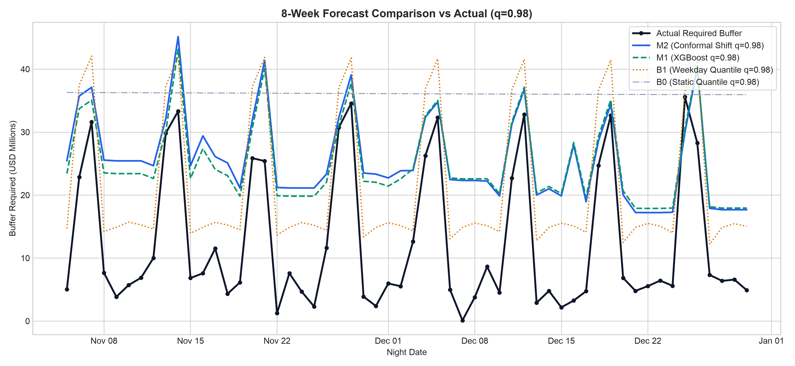
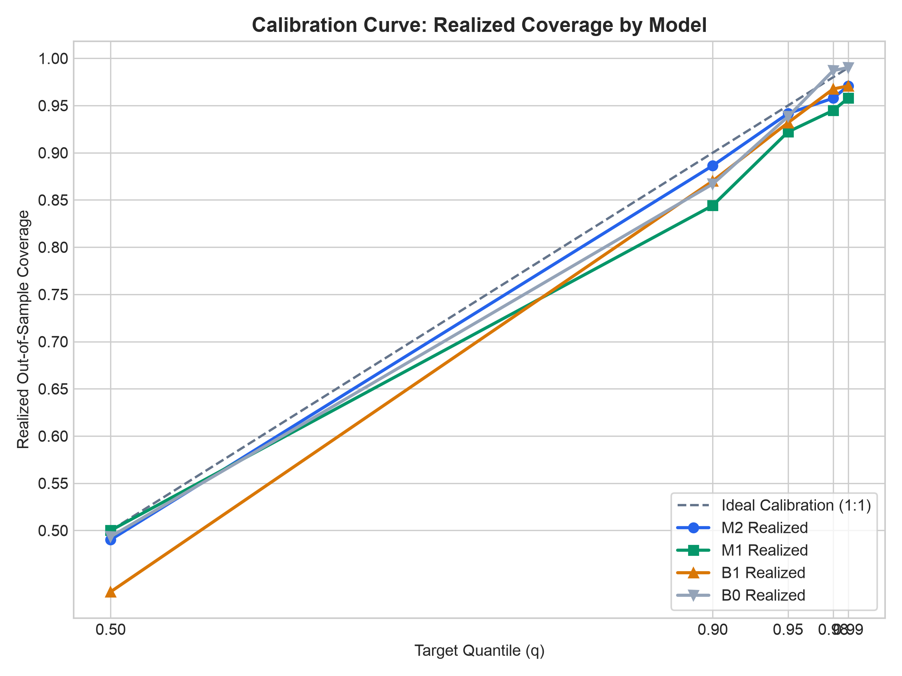

# Nightly Buffer Forecast Engine: Backtest Results

Evaluation framework: Walk-forward expanding window starting at night index 56 through 363 (308 out-of-sample nights). Models retrained every 7 nights using strictly prior history.

Cost parameters:
- $C_u$ (under-buffering early redemption penalty): 0.5%
- $C_o$ (over-buffering opportunity cost): overnight repo yield per dollar ($rate / 100 / 365$)
- Total Cost = Total Shortfall $\times C_u + \sum (\text{Buffer} \times \text{Repo Rate} / 365)$

---

## 1. Visualizations

---

## 2. Performance Tables

### Table 1: All Evaluation Nights (308 Nights)

| Model | Quantile | Coverage | Pinball Loss ($) | Mean Buffer ($) | Shortfalls | Shortfall ($) | Total Cost ($) |
|:---|---:|---:|---:|---:|---:|---:|---:|
| B0   | 0.50 |   0.4935 |     4,309,847.08 |    7,650,692.01 |        156 | 2,167,181,571.56 |  11,095,421.92 |
| B0   | 0.90 |   0.8669 |     2,162,687.48 |   31,097,344.08 |         41 |  111,900,593.66 |   1,614,129.20 |
| B0   | 0.95 |   0.9383 |     1,190,193.94 |   33,052,489.00 |         19 |   59,366,928.05 |   1,418,081.99 |
| B0   | 0.98 |   0.9870 |       546,668.02 |   36,060,683.72 |          4 |   26,958,146.75 |   1,357,492.98 |
| B0   | 0.99 |   0.9903 |       318,620.88 |   37,999,555.32 |          3 |   21,455,706.69 |   1,396,697.33 |
| B1   | 0.50 |   0.4351 |     1,498,422.49 |   12,506,167.85 |        174 |  553,519,519.93 |   3,191,794.20 |
| B1   | 0.90 |   0.8701 |       871,835.58 |   17,247,223.36 |         40 |  140,901,928.31 |   1,289,363.58 |
| B1   | 0.95 |   0.9318 |       605,358.38 |   19,037,964.22 |         21 |   95,061,256.77 |   1,120,865.50 |
| B1   | 0.98 |   0.9675 |       378,714.47 |   21,655,116.39 |         10 |   63,966,749.69 |   1,054,015.08 |
| B1   | 0.99 |   0.9708 |       292,810.14 |   23,159,633.12 |          9 |   59,212,956.64 |   1,081,575.47 |
| B2   | 0.50 |   0.7987 |     2,770,213.22 |   17,254,851.32 |         62 |  213,933,809.78 |   1,654,818.35 |
| B2   | 0.90 |   0.7987 |     1,109,714.88 |   17,254,851.32 |         62 |  213,933,809.78 |   1,654,818.35 |
| B2   | 0.95 |   0.7987 |       902,152.58 |   17,254,851.32 |         62 |  213,933,809.78 |   1,654,818.35 |
| B2   | 0.98 |   0.7987 |       777,615.21 |   17,254,851.32 |         62 |  213,933,809.78 |   1,654,818.35 |
| B2   | 0.99 |   0.7987 |       736,102.75 |   17,254,851.32 |         62 |  213,933,809.78 |   1,654,818.35 |
| M1   | 0.50 |   0.5000 |     1,614,440.09 |   12,649,696.75 |        154 |  567,149,487.02 |   3,264,945.90 |
| M1   | 0.90 |   0.8442 |       872,584.38 |   17,139,515.25 |         48 |  144,449,967.47 |   1,303,395.24 |
| M1   | 0.95 |   0.9221 |       632,095.76 |   20,557,691.06 |         24 |   79,892,576.52 |   1,096,410.45 |
| M1   | 0.98 |   0.9448 |       482,543.87 |   29,427,515.59 |         17 |   48,068,223.99 |   1,237,365.55 |
| M1   | 0.99 |   0.9578 |       322,801.29 |   33,951,495.98 |         13 |   35,211,293.87 |   1,326,809.32 |
| M2   | 0.50 |   0.4903 |     1,640,969.60 |   12,829,148.91 |        157 |  547,684,945.00 |   3,173,841.65 |
| M2   | 0.90 |   0.8864 |       903,878.33 |   18,260,821.88 |         35 |  119,552,259.58 |   1,216,482.61 |
| M2   | 0.95 |   0.9416 |       630,782.62 |   21,509,651.70 |         18 |   64,827,933.44 |   1,052,957.43 |
| M2   | 0.98 |   0.9578 |       476,863.68 |   30,707,681.19 |         13 |   38,432,905.99 |   1,232,896.13 |
| M2   | 0.99 |   0.9708 |       315,404.97 |   35,340,843.54 |          9 |   28,654,037.29 |   1,342,318.54 |
### Table 2: Friday & Saturday Nights Only (88 Nights)

| Model | Quantile | Coverage | Pinball Loss ($) | Mean Buffer ($) | Shortfalls | Shortfall ($) | Total Cost ($) |
|:---|---:|---:|---:|---:|---:|---:|---:|
| B0   | 0.50 |   0.0000 |    11,033,140.83 |    7,643,868.10 |         88 | 1,941,832,785.37 |   9,783,260.05 |
| B0   | 0.90 |   0.5341 |     1,406,382.81 |   31,058,001.29 |         41 |  111,900,593.66 |     860,506.89 |
| B0   | 0.95 |   0.7841 |       840,340.83 |   33,024,482.72 |         19 |   59,366,928.05 |     616,997.37 |
| B0   | 0.98 |   0.9545 |       433,265.78 |   36,056,309.71 |          4 |   26,958,146.75 |     484,156.26 |
| B0   | 0.99 |   0.9659 |       326,157.34 |   37,944,399.33 |          3 |   21,455,706.69 |     475,228.62 |
| B1   | 0.50 |   0.4091 |     1,816,395.73 |   29,642,904.86 |         52 |  162,801,599.35 |   1,101,263.19 |
| B1   | 0.90 |   0.8636 |       900,018.75 |   34,054,022.48 |         12 |   40,975,570.11 |     534,901.36 |
| B1   | 0.95 |   0.9205 |       646,668.90 |   35,924,419.97 |          7 |   29,564,073.83 |     496,066.27 |
| B1   | 0.98 |   0.9773 |       383,875.29 |   38,655,553.35 |          2 |   18,037,115.21 |     464,889.87 |
| B1   | 0.99 |   0.9773 |       282,338.47 |   40,357,436.91 |          2 |   15,476,172.70 |     468,722.48 |
| B2   | 0.50 |   0.7614 |     2,993,278.83 |   34,306,322.87 |         21 |   61,176,920.02 |     638,494.94 |
| B2   | 0.90 |   0.7614 |     1,154,809.58 |   34,306,322.87 |         21 |   61,176,920.02 |     638,494.94 |
| B2   | 0.95 |   0.7614 |       925,000.93 |   34,306,322.87 |         21 |   61,176,920.02 |     638,494.94 |
| B2   | 0.98 |   0.7614 |       787,115.74 |   34,306,322.87 |         21 |   61,176,920.02 |     638,494.94 |
| B2   | 0.99 |   0.7614 |       741,154.00 |   34,306,322.87 |         21 |   61,176,920.02 |     638,494.94 |
| M1   | 0.50 |   0.4091 |     2,025,491.59 |   28,141,194.84 |         52 |  247,277,275.80 |   1,509,040.42 |
| M1   | 0.90 |   0.7159 |     1,239,611.90 |   32,368,539.34 |         25 |   85,692,018.47 |     742,116.00 |
| M1   | 0.95 |   0.7500 |       952,386.33 |   33,410,381.82 |         22 |   67,528,975.78 |     661,480.34 |
| M1   | 0.98 |   0.8068 |       629,008.97 |   33,849,107.16 |         17 |   48,068,223.99 |     568,533.20 |
| M1   | 0.99 |   0.8523 |       453,388.60 |   35,036,175.82 |         13 |   35,211,293.87 |     515,534.48 |
| M2   | 0.50 |   0.3977 |     2,022,566.96 |   28,305,216.82 |         53 |  239,802,941.53 |   1,473,296.75 |
| M2   | 0.90 |   0.7955 |     1,197,145.63 |   33,472,230.17 |         18 |   72,242,508.13 |     685,433.09 |
| M2   | 0.95 |   0.8182 |       821,953.12 |   34,281,628.42 |         16 |   52,217,368.39 |     593,251.85 |
| M2   | 0.98 |   0.8523 |       542,379.83 |   34,992,262.98 |         13 |   38,432,905.99 |     531,518.54 |
| M2   | 0.99 |   0.8977 |       391,578.70 |   36,306,613.89 |          9 |   28,654,037.29 |     495,420.02 |
### Table 3: Nights Containing a >4-Sigma Outlier Hour (24 Nights)

| Model | Quantile | Coverage | Pinball Loss ($) | Mean Buffer ($) | Shortfalls | Shortfall ($) | Total Cost ($) |
|:---|---:|---:|---:|---:|---:|---:|---:|
| B0   | 0.50 |   0.4615 |     4,466,603.03 |    7,621,461.47 |         14 |  185,280,099.56 |     948,079.04 |
| B0   | 0.90 |   0.8846 |     2,932,459.02 |   31,019,274.50 |          3 |   29,239,304.86 |     234,419.21 |
| B0   | 0.95 |   0.9231 |     1,968,359.67 |   33,044,815.61 |          2 |   25,041,833.03 |     219,231.14 |
| B0   | 0.98 |   0.9231 |     1,223,914.12 |   35,998,978.58 |          2 |   19,831,395.10 |     201,518.47 |
| B0   | 0.99 |   0.9231 |       936,978.21 |   37,721,455.32 |          2 |   17,918,403.50 |     196,931.87 |
| B1   | 0.50 |   0.3462 |     2,817,331.60 |    9,107,729.89 |         17 |  123,077,552.87 |     641,416.38 |
| B1   | 0.90 |   0.6538 |     2,923,816.37 |   14,151,886.86 |          9 |   72,869,803.74 |     404,699.69 |
| B1   | 0.95 |   0.7308 |     2,602,461.94 |   15,730,657.95 |          7 |   64,036,897.07 |     365,010.02 |
| B1   | 0.98 |   0.7692 |     2,170,181.47 |   18,275,071.34 |          6 |   53,650,778.02 |     320,280.95 |
| B1   | 0.99 |   0.8077 |     1,992,044.53 |   19,535,306.58 |          5 |   50,078,526.54 |     306,012.56 |
| B2   | 0.50 |   0.6154 |     4,312,402.85 |   15,149,984.74 |         10 |   83,400,092.37 |     460,120.44 |
| B2   | 0.90 |   0.6154 |     3,428,637.26 |   15,149,984.74 |         10 |   83,400,092.37 |     460,120.44 |
| B2   | 0.95 |   0.6154 |     3,318,166.56 |   15,149,984.74 |         10 |   83,400,092.37 |     460,120.44 |
| B2   | 0.98 |   0.6154 |     3,251,884.14 |   15,149,984.74 |         10 |   83,400,092.37 |     460,120.44 |
| B2   | 0.99 |   0.6154 |     3,229,790.00 |   15,149,984.74 |         10 |   83,400,092.37 |     460,120.44 |
| M1   | 0.50 |   0.3846 |     2,753,199.73 |    9,491,843.82 |         16 |  116,416,643.23 |     609,174.47 |
| M1   | 0.90 |   0.6538 |     2,399,779.73 |   14,542,410.29 |          9 |   58,229,490.11 |     332,519.74 |
| M1   | 0.95 |   0.8462 |     1,621,561.60 |   18,364,526.69 |          4 |   35,109,458.78 |     227,855.52 |
| M1   | 0.98 |   0.9231 |     1,244,418.67 |   29,212,521.92 |          2 |   23,893,470.71 |     202,490.42 |
| M1   | 0.99 |   0.8846 |     1,097,866.50 |   33,695,912.77 |          3 |   23,148,139.97 |     211,495.46 |
| M2   | 0.50 |   0.3462 |     2,698,654.38 |    9,631,978.38 |         17 |  113,176,714.70 |     593,394.67 |
| M2   | 0.90 |   0.6538 |     2,435,701.72 |   15,770,490.60 |          9 |   55,970,453.16 |     324,681.70 |
| M2   | 0.95 |   0.8462 |     1,409,051.18 |   19,565,219.93 |          4 |   28,023,286.75 |     195,820.15 |
| M2   | 0.98 |   0.9231 |     1,151,210.90 |   30,611,108.21 |          2 |   20,742,803.93 |     190,782.90 |
| M2   | 0.99 |   0.9231 |       832,395.27 |   35,206,720.87 |          2 |   15,853,078.04 |     179,473.95 |
